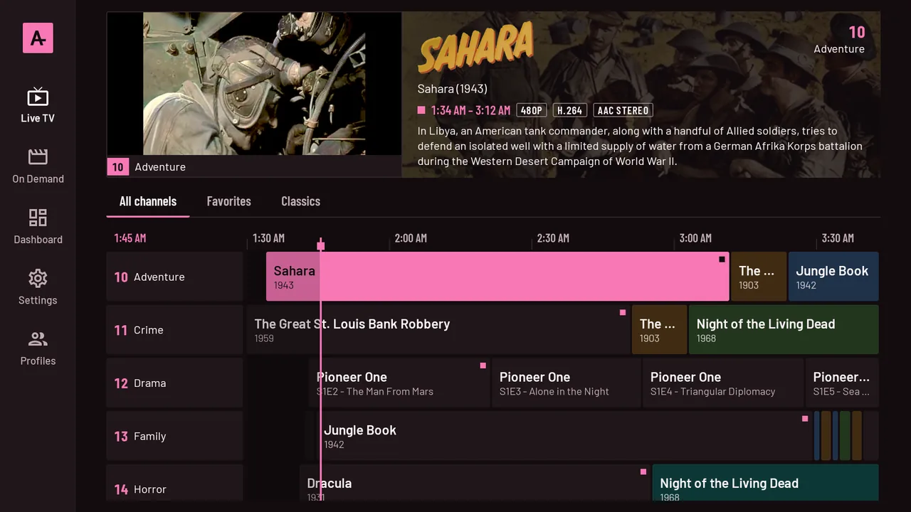
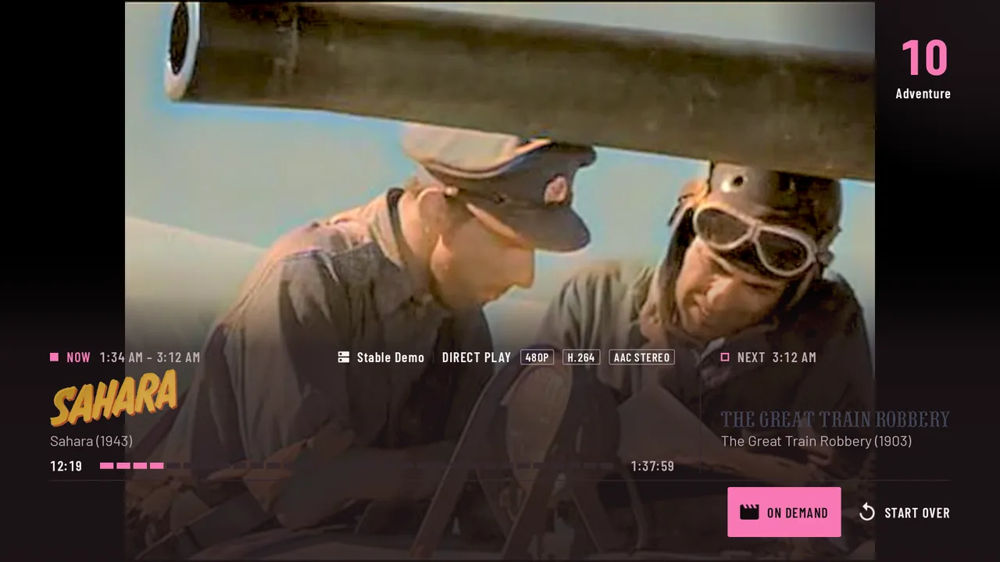
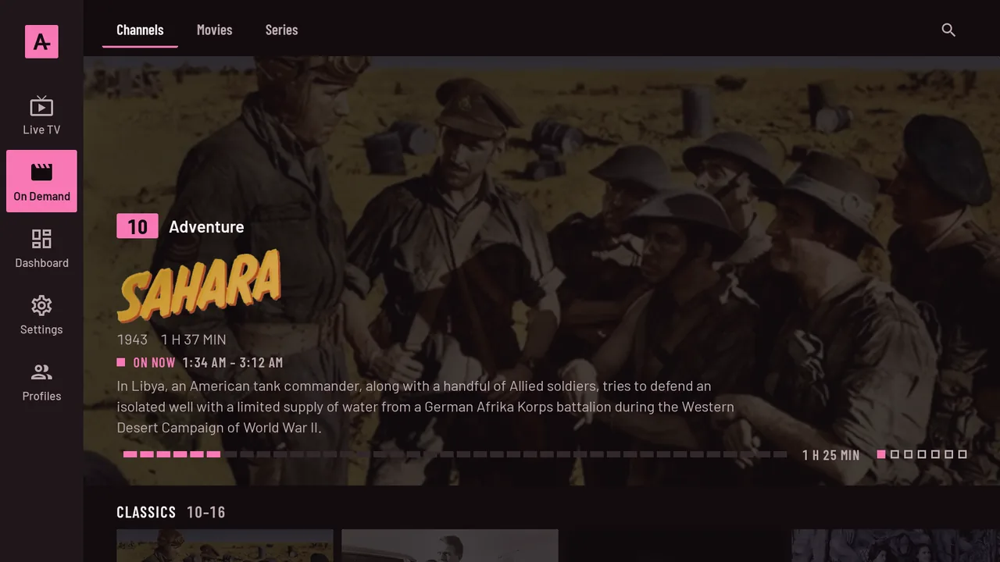
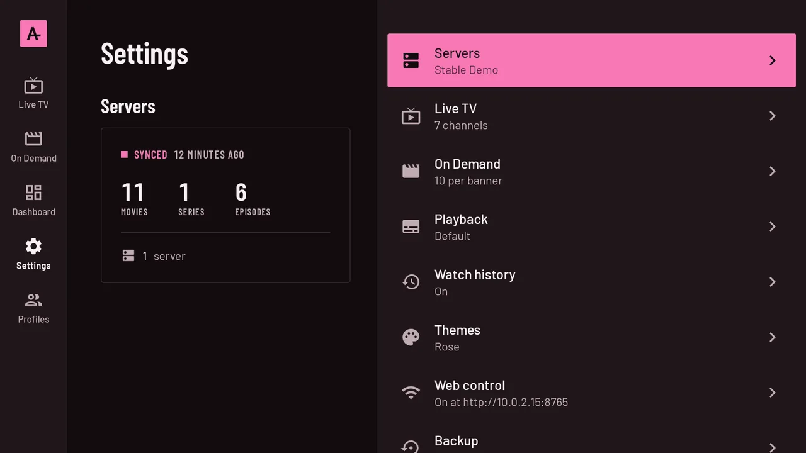
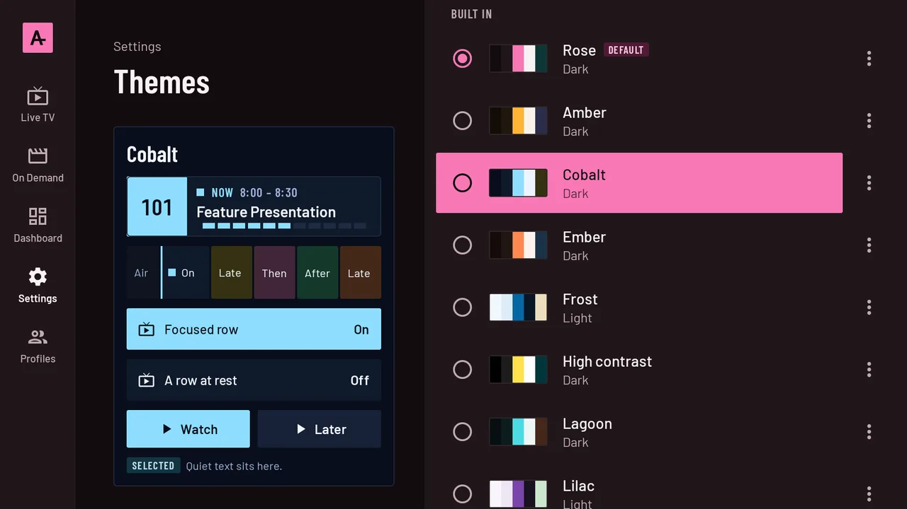

#  AnstelleTV

[](LICENSE)


Your Jellyfin library, on the air around the clock.

AnstelleTV turns a Jellyfin library into 24/7 retro cable TV. *Anstelle* is German for "instead of", literally "in the place of", and the app takes the place of a cable subscription. It builds channels from the metadata the library already has and gives each one a wall-clock schedule, so you turn it on, surf, and land on whatever is airing. When you do want to choose, On Demand is organized by channel.

One APK runs on Android TV, Google TV and Fire TV with a remote, and on phones and tablets with touch. There is no second server to run. Tools such as Tunarr and ErsatzTV need their own server plus an IPTV client; AnstelleTV keeps channels, schedules and settings in an on-device database and serves its own admin web UI on the local network.

QuasiTV and NostalgiaTV also run on the TV itself, but both sell an upgrade: QuasiTV for more than ten custom channels, NostalgiaTV for channel editing and themes. AnstelleTV is free and open source under the GPL, with no ads, subscriptions or paid features.



## Features

- Channels made from the library's genres, tags, decades and studios, in four numbered groups, right after sign-in
- Back-to-back schedules with no filler, ads or station breaks, and a 7-day guide grid with a live preview
- Surfing with the channel keys, number entry or a swipe, with the channels on either side kept ready to play
- Seeking or restarting a program moves the channel's schedule, so the guide always matches the screen
- On Demand by channel, plus Movies, Series and Search, with Jellyfin resume points and skippable intros and credits from Jellyfin's media segments
- Direct play where the device can decode the file, HLS from Jellyfin where it can't, on-device AC3, E-AC3, DTS and TrueHD audio, and fully styled ASS/SSA subtitles
- Profiles that are Jellyfin users, with owner, admin and member roles, PINs and parental ratings; restricted programs still air but are blacked out
- A rule-based lineup builder for channels of your own
- A per-profile dashboard of what you watched and when
- 16 built-in themes and a theme designer
- An admin web UI on the LAN, paired with a PIN shown on the TV
- Backups to a file, or copied straight from another AnstelleTV on the network

## Screenshots

<p>
  
  
</p>
<p>
  
  
</p>

Taken on a Google TV emulator signed in to Jellyfin's public demo server.

## Quick start

With a device or emulator connected over `adb`, Android SDK platform 37 installed, and Node 22.17+ with pnpm (or Corepack) on the PATH:

```sh
git clone https://github.com/EagleStelle/AnstelleTV.git
cd AnstelleTV
./gradlew installDebug
```

Open AnstelleTV on the device, enter your Jellyfin server's address, and sign in with Quick Connect or a password. Channels appear in Live TV once the first library sync finishes.

To reach the web admin from the same computer:

```sh
adb forward tcp:8765 tcp:8765
```

Then turn on Settings > Web control on the device, open `http://localhost:8765`, and enter the PIN the device shows.

## Technologies used

Android app

- Kotlin 2.4 and Jetpack Compose: Material 3 on phones, Compose for TV (`tv-material`) on TV
- Hilt for dependency injection, Room for the database, WorkManager for sync and schedule jobs
- Media3 ExoPlayer with HLS, the Jellyfin FFmpeg audio decoder (AC3, E-AC3, DTS, TrueHD) and libass (`ass-media`) for ASS/SSA subtitles
- Jellyfin Kotlin SDK and OkHttp for the server, Coil 3 for images
- Ktor CIO for the embedded web server, kotlinx.serialization for JSON

Web UI

- SvelteKit 3 (static adapter), Svelte 5, TypeScript 6, Vite 8
- Tailwind CSS 4 with theme-role tokens, `unplugin-icons`

Build and tooling

- Gradle 9.8 with convention plugins in `build-logic`, a version catalog and type-safe project accessors
- AGP 9.4, KSP, R8 full mode, Baseline Profiles and Macrobenchmark
- Python scripts in `tools/` that generate the built-in themes and the brand icons

## Quick installation

1. Install JDK 17 or newer, the Android SDK with platform 37, and Node 22.17+ with pnpm 12.9.1 (Corepack works too).
2. Run `./gradlew assembleDebug`. It builds the web UI with pnpm and packs it into the APK.
3. Install `app/build/outputs/apk/debug/app-debug.apk` on a device or emulator.

[docs/installation.md](docs/installation.md) covers release builds, signing and how to check that everything works.

## Architecture (summary)

Data flows one way: the Jellyfin SDK syncs library metadata into Room; `ChannelGenerator` derives channels from that metadata; a pure-JVM `ScheduleEngine` turns each channel's lineup into back-to-back airings kept 8 days ahead; and the player tunes by reading the current airing from SQLite, with no server call at tune time. Compose feature modules sit on top of shared repositories in `core:data`, and a Ktor server running as a foreground service exposes an admin API and the SvelteKit app to paired browsers on the LAN. See [docs/architecture.md](docs/architecture.md).

## Project structure

```
AnstelleTV/
├── app/              Application module: activity, navigation, Hilt wiring, packed web UI
├── build-logic/      Gradle convention plugins (anstelle.*)
├── core/
│   ├── model/        Pure Kotlin models and enums with stable storage codes
│   ├── common/       TimeSource, dispatchers, AppLog
│   ├── scheduler/    Pure JVM schedule engine
│   ├── database/     Room database, DAOs, exported schemas
│   ├── jellyfin/     Jellyfin SDK client, sign-in, token store, library source
│   ├── player/       ExoPlayer pool, stream planning, subtitles
│   ├── theme/        Theme spec, Compose theme, shared focusable components
│   ├── data/         Repositories, sync, channels, playback, stats, backup, workers
│   └── livetv/       Placeholder for the skipped Live TV phase
├── feature/          guide, player, ondemand, profiles, settings, dashboard
├── webserver/        Ktor server, pairing, LAN guard, admin API, /ws
├── webui/            SvelteKit admin SPA
├── baselineprofile/  Baseline profile generator
├── benchmark/        Macrobenchmarks
├── tools/            Theme and brand generators (Python)
└── docs/             This documentation and performance reports
```

See [docs/structure.md](docs/structure.md) for the full tree.

## Documentation

| Page | Contents |
|---|---|
| [Usage guide](docs/usage.md) | First run, surfing, the guide, on demand, profiles, web admin, backups |
| [Installation](docs/installation.md) | Toolchain, building, installing and checking it works |
| [Architecture](docs/architecture.md) | How data moves from Jellyfin to the screen, and the patterns each layer uses |
| [Structure](docs/structure.md) | Every module and folder, and what belongs in each |
| [Technical decisions](docs/decisions.md) | Trade-offs and the reasons behind them |
| [Web API](docs/api.md) | The LAN HTTP API and WebSocket the web UI uses |
| [Testing](docs/testing.md) | Unit, instrumented and benchmark tests, and how to run them |

## Support and contributing

Report bugs and ask questions in [GitHub Issues](https://github.com/EagleStelle/AnstelleTV/issues). Pull requests are welcome. Read [docs/architecture.md](docs/architecture.md) and [docs/testing.md](docs/testing.md) first, and run the unit tests and `./gradlew lintDebug` before opening one.

## License

AnstelleTV is licensed under the [GNU General Public License v3.0](LICENSE). The bundled Barlow fonts are under the SIL Open Font License ([core/theme/licenses/barlow-OFL.txt](core/theme/licenses/barlow-OFL.txt)).
